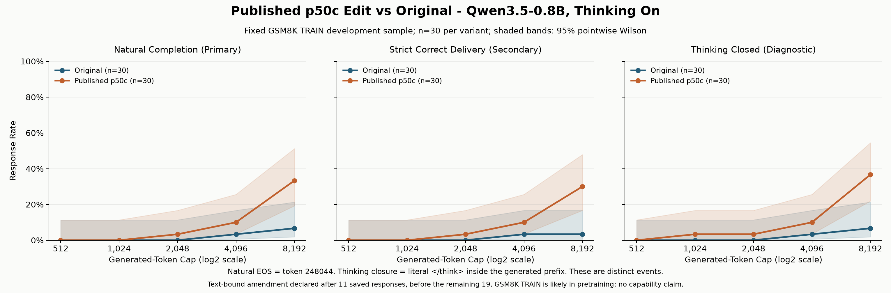

# Weight-Space Lab

A local, reproducible research lab for inspecting and reversibly applying the
published p50c weight edit to Qwen3.5-0.8B. This is an inference and measurement
project, not a fine-tuning pipeline or a claim to reproduce the article's benchmark.

## Latest Completed Comparison

Thirty matched GSM8K TRAIN development questions, thinking on, one seed per
question, and an 8,192-generated-token cap:

| Outcome | Original | Published p50c |
| --- | ---: | ---: |
| Natural completion, primary | 2/30 (6.7%) | 10/30 (33.3%) |
| Strict correct delivery, secondary | 1/30 (3.3%) | 9/30 (30.0%) |
| Thinking closed, diagnostic | 2/30 (6.7%) | 11/30 (36.7%) |

The primary paired effect is +26.7 percentage points: 9 edited wins, 1 original
win and 20 ties. Exact McNemar p=0.0215; Holm-adjusted p=0.1074 across five caps.
**The primary result does not clear the predeclared multiplicity adjustment.**
Secondary results do not replace that endpoint.

A text-bound handling amendment was declared after 11 saved responses and before
the remaining 19 generations. Raw IDs/text are saved before response validation;
out-of-bound text is strict-incorrect while EOS and closure remain token-based.
One response had 669,118 characters. The original 11 records and outcomes did not
change, and the failed attempt's full 8,192-token charge remains in the accounting.

GSM8K TRAIN is likely in Qwen's training data; per-item inclusion is unverified.
These small, one-model development results are **not a capability or benchmark claim**.



- [Full p50c report](docs/reports/P50C_COMPLETION_REPORT.md)
- [Unedited token-budget report](docs/reports/BUDGET_SWEEP_REPORT.md)
- [Prompt controls](docs/reports/PROMPT_CONTROL_REPORT.md)
- [Earlier controlled pilot](docs/reports/EXPERIMENT_REPORT.md)
- [Curated aggregate results](docs/results/)

## Repository Layout

```text
src/                    Byte-preserved experimental modules and CLI workers
tests/legacy/           Original 140 offline research regression tests
tests/repository/       Portable publication/layout tests
notebooks/              Clean notebook copies, without saved outputs
docs/reports/           Curated historical reports
docs/figures/           PNG and SVG results
docs/results/           Aggregate JSON; no raw responses or questions
docs/provenance/        Prospective endpoint declaration
scripts/lab.py          Safe local workbench, test and notebook commands
tools/                  Standard-library repository and migration checks
repository-layout.json Source locations and exact historical byte hashes
requirements.in         Exact direct pins
requirements.lock       Complete hash-pinned Windows/Python 3.12 environment
```

Model weights, downloaded datasets, full raw runs, credentials, caches,
machine-specific Jupyter files and the original executed notebooks are not
published. Existing local inputs remain untouched. See
[reproducibility and archive policy](docs/REPRODUCIBILITY.md).

The research modules intentionally retain their original bytes and flat imports.
Do not run them directly from `src/` or automatically reformat them: their source
hashes are part of the completed experiment. The launcher reconstructs their
expected flat layout under ignored `.local/workbench/` instead.

## Quick Start

Portable checks require only Python 3.12 and Git; they do not install packages,
download data, import the model or run inference:

```powershell
python tools/check_repo.py
python -m unittest discover -s tests/repository -v
```

On the original machine, using the existing pinned environment and cached inputs:

```powershell
.\.venv\Scripts\python.exe scripts/lab.py prepare --with-local-data
.\.venv\Scripts\python.exe scripts/lab.py test
.\.venv\Scripts\python.exe scripts/lab.py verify
.\.venv\Scripts\python.exe scripts/lab.py notebook
```

Start with [notebook 00](notebooks/00_results_overview.ipynb), which reads only the
published aggregates and figure. Notebooks 01-07 are clean copies of the original
lab notebooks and need the corresponding local inputs. Their original saved
outputs remain in the ignored local audit archive; full notebook 07 also remains
inside the original completed run. Notebooks 01/02 require explicit GPU opt-in;
03's optional activation check is off. Saved-run notebooks keep inference off.

Fresh clones do not contain the historical audit pack and cannot claim independent
raw-response re-grading from the curated aggregates alone.
[Setup](docs/SETUP.md) explains the environment and data boundaries.

## Safety And Publication

- Original checkpoints are never overwritten or saved after editing.
- Fresh starts/resumes verify the active edit before generation; accepted records
  carry the planned tensor hashes, and cleanup verifies restoration.
- No held-out inference, additional model runs or downloads occur during repository preparation.
- Jupyter binds to loopback with its default authentication intact.
- Changes go through a feature branch and pull request; no force-pushes or protection bypasses.
- No project-wide license grant has been selected. Third-party materials retain
  their own terms; see [third-party notices](THIRD_PARTY_NOTICES.md).
