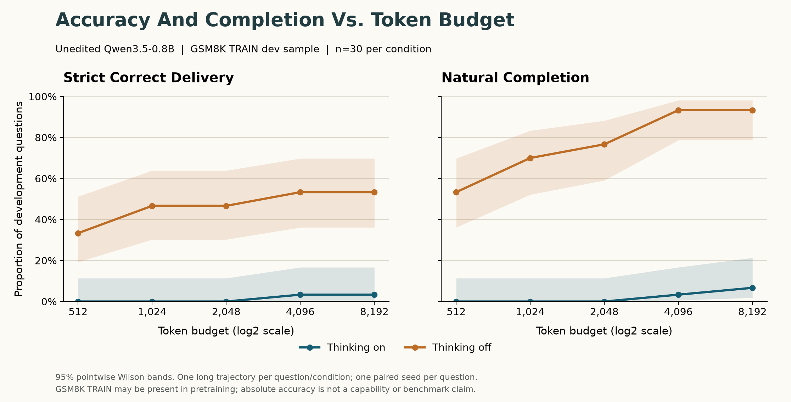

# Accuracy Vs. Token Budget: Unedited Qwen3.5-0.8B

> Curated copy of a completed historical report. Original flat-layout paths refer to the local workbench reconstructed by `scripts/lab.py`; full raw runs are not distributed with the code. The original report is preserved locally.


We compared thinking on and off on 30 GSM8K TRAIN development questions using the same unedited Qwen3.5-0.8B checkpoint and one seed per question. One completed trajectory per question and condition was saved with an 8,192-token maximum and counted correct only after natural EOS and strict boxed-integer grading. At 1,024 and 8,192 tokens, thinking-on accuracy was 0.0% and 3.3%, compared with 46.7% and 53.3% with thinking off. GSM8K TRAIN is likely to be in Qwen's training data, although per-item inclusion is unverified. These observations describe this small fixed experiment, not new capability, a benchmark score, or generalization to other models or questions.


## Question


Under a fixed step-by-step instruction, does thinking-on correct delivery rise substantially with budget while thinking-off stays approximately flat?


## Fixed Design


- Model: `Qwen/Qwen3.5-0.8B`, revision `2fc06364715b967f1860aea9cf38778875588b17`, BF16, eager attention, CUDA, batch 1.

- Data: 30 integer-answer GSM8K `main` TRAIN items, MIT, revision `740312add88f781978c0658806c59bc2815b9866`, sampling seed 20261106; seeds 0-29 are paired across conditions.

- Data SHA-256: `ea82612ea9582142387730c793eb67d3b12849002bc0b7fa6f8efafa7351419d`; curated pool SHA-256: `f457da0d4bc3acc6d6b9d8b1e98e363786c8497aa195b1f229f7897565c4777d`.

- Unchanged step-by-step prompt and sampling: temperature 0.6, top-p 0.95, top-k 20, generated-token presence penalty 1.5, repetition penalty 1.0.

- One 8192-token maximum generation per question/condition; all five caps are derived afterwards. Four real 1024-token prefix runs reuse their four long counterparts in the main set.

- Strict natural EOS is 248044 only. Token 248046 is diagnostic only. A box in unfinished reasoning is not correct delivery.

- Accuracy/completion have 95% pointwise Wilson intervals; mean tokens = mean(min(length,cap)), without a Wilson interval. Exact paired McNemar plus Holm adjustment covers five cap comparisons.

- No time-based generation stop; fixed threads 1/1 and strict deterministic algorithms with no warn-only fallback.

- CUBLAS_WORKSPACE_CONFIG: `:4096:8`; before-CUDA setup and runtime policy: `{'CUBLAS_WORKSPACE_CONFIG': ':4096:8', 'deterministic_algorithms': True, 'deterministic_warn_only': False, 'set_before_cuda_initialization': True, 'torch_interop_threads': 1, 'torch_threads': 1, 'wall_time_limit': None}`.

- No held-out question was generated or scored; no weight edits, model saves, package installation, or new data/model downloads.

- Run: `results/budget_sweep_20261106T191821_788114Z`. Plan and implementation source hashes are saved with explicit approval.


## Results


Run status: **complete**; main responses: **60/60**.

| Thinking | Cap | n | Correct Delivery (95% Wilson) | Natural Completion (95% Wilson) | Mean Tokens |
|---|---:|---:|---|---|---:|
| on | 512 | 30 | 0/30 = 0.0% (0.0-11.4%) | 0/30 = 0.0% (0.0-11.4%) | 512.0 |
| on | 1024 | 30 | 0/30 = 0.0% (0.0-11.4%) | 0/30 = 0.0% (0.0-11.4%) | 1024.0 |
| on | 2048 | 30 | 0/30 = 0.0% (0.0-11.4%) | 0/30 = 0.0% (0.0-11.4%) | 2048.0 |
| on | 4096 | 30 | 1/30 = 3.3% (0.6-16.7%) | 1/30 = 3.3% (0.6-16.7%) | 4047.9 |
| on | 8192 | 30 | 1/30 = 3.3% (0.6-16.7%) | 2/30 = 6.7% (1.8-21.3%) | 7932.7 |
| off | 512 | 30 | 10/30 = 33.3% (19.2-51.2%) | 16/30 = 53.3% (36.1-69.8%) | 455.5 |
| off | 1024 | 30 | 14/30 = 46.7% (30.2-63.9%) | 21/30 = 70.0% (52.1-83.3%) | 621.8 |
| off | 2048 | 30 | 14/30 = 46.7% (30.2-63.9%) | 23/30 = 76.7% (59.1-88.2%) | 892.1 |
| off | 4096 | 30 | 16/30 = 53.3% (36.1-69.8%) | 28/30 = 93.3% (78.7-98.2%) | 1222.9 |
| off | 8192 | 30 | 16/30 = 53.3% (36.1-69.8%) | 28/30 = 93.3% (78.7-98.2%) | 1496.0 |





Mean tokens is counterfactual consumption at each cap, not additional compute spent after the single long generation.


## Paired Effects


| Cap | On Wins | Off Wins | Ties | Exact McNemar p | Holm p |
|---:|---:|---:|---:|---:|---:|
| 512 | 0 | 10 | 20 | 0.00195312 | 0.00195312 |
| 1024 | 0 | 14 | 16 | 0.00012207 | 0.000366211 |
| 2048 | 0 | 14 | 16 | 0.00012207 | 0.000366211 |
| 4096 | 0 | 15 | 15 | 6.10352e-05 | 0.000305176 |
| 8192 | 0 | 15 | 15 | 6.10352e-05 | 0.000305176 |


From 1024 to 8192, thinking on gains 1/30 correct answers and thinking off gains 2/30. The predeclared on>=8/30 and off<=3/30 pattern is **not consistent** with these data.


## Truncation And Runtime


```text
{
  "passed": true,
  "failed": false,
  "comparisons": [
    {
      "problem_id": "gsm8k_train_06819",
      "condition": "thinking_on",
      "identical": true,
      "short_tokens": 1024,
      "long_tokens": 8192
    },
    {
      "problem_id": "gsm8k_train_06819",
      "condition": "thinking_off",
      "identical": true,
      "short_tokens": 490,
      "long_tokens": 490
    },
    {
      "problem_id": "gsm8k_train_03171",
      "condition": "thinking_on",
      "identical": true,
      "short_tokens": 1024,
      "long_tokens": 8192
    },
    {
      "problem_id": "gsm8k_train_03171",
      "condition": "thinking_off",
      "identical": true,
      "short_tokens": 465,
      "long_tokens": 465
    }
  ]
}
```

```text
{
  "aggregate_pilot_tokens_per_second": 19.576378728072836,
  "all_remaining_responses_at_cap_finish_utc": "2026-11-07T01:35:58.825872+00:00",
  "measured_at_utc": "2026-11-06T19:35:45.046219+00:00",
  "note": "Projection from two pilot questions, not a deadline. Rates may change with longer contexts.",
  "peak_gpu_allocated_bytes": 1963789824,
  "per_condition": {
    "thinking_off": {
      "pilot_main_seconds": 40.65623050000431,
      "pilot_main_tokens": 955,
      "remaining_main_responses": 28,
      "tokens_per_second": 23.489634632996747
    },
    "thinking_on": {
      "pilot_main_seconds": 846.3422618999903,
      "pilot_main_tokens": 16384,
      "remaining_main_responses": 28,
      "tokens_per_second": 19.358598450724713
    }
  },
  "projected_finish_utc": "2026-11-06T23:02:43.025113+00:00",
  "projected_remaining_seconds": 12417.978893599924
}
```


Longest recorded generation wall time: 30666.15 seconds, `gsm8k_train_06229` / `thinking_on` / `main`, 5952 tokens. Wall time includes any host pauses or delays; their cause is not diagnosed by these logs. All recorded durations are retained. An initial ETA does not account for later pauses and is not a deadline.


Throughput estimates use measured generation wall time; GPU memory is peak PyTorch allocated memory, not total device usage. ETA is a projection, never a stop condition.


## Token 248046 Diagnostics


| Thinking | Records | Responses Containing 248046 | Token 248046 Occurrences |
|---|---|---:|---:|
| on | main | 2/30 | 2 |
| on | prefix_validation_short | 0/2 | 0 |
| on | all | 2/32 | 2 |
| off | main | 28/30 | 28 |
| off | prefix_validation_short | 2/2 | 2 |
| off | all | 30/32 | 30 |


Every affected response is identified in summary.json and carries an occurrence count in records.jsonl. Main and validation counts are separate to avoid double-counting the main comparison. No stop or scoring rule changed.


Affected responses (thinking_on):

- `gsm8k_train_06229` / `main`: 1 occurrences.

- `gsm8k_train_01026` / `main`: 1 occurrences.


Affected responses (thinking_off):

- `gsm8k_train_06819` / `prefix_validation_short`: 1 occurrences.

- `gsm8k_train_06819` / `main`: 1 occurrences.

- `gsm8k_train_03171` / `prefix_validation_short`: 1 occurrences.

- `gsm8k_train_03171` / `main`: 1 occurrences.

- `gsm8k_train_05037` / `main`: 1 occurrences.

- `gsm8k_train_06229` / `main`: 1 occurrences.

- `gsm8k_train_01026` / `main`: 1 occurrences.

- `gsm8k_train_05128` / `main`: 1 occurrences.

- `gsm8k_train_05283` / `main`: 1 occurrences.

- `gsm8k_train_06305` / `main`: 1 occurrences.

- `gsm8k_train_01227` / `main`: 1 occurrences.

- `gsm8k_train_04331` / `main`: 1 occurrences.

- `gsm8k_train_05040` / `main`: 1 occurrences.

- `gsm8k_train_02232` / `main`: 1 occurrences.

- `gsm8k_train_03114` / `main`: 1 occurrences.

- `gsm8k_train_00949` / `main`: 1 occurrences.

- `gsm8k_train_02809` / `main`: 1 occurrences.

- `gsm8k_train_01407` / `main`: 1 occurrences.

- `gsm8k_train_06959` / `main`: 1 occurrences.

- `gsm8k_train_02855` / `main`: 1 occurrences.

- `gsm8k_train_01238` / `main`: 1 occurrences.

- `gsm8k_train_03547` / `main`: 1 occurrences.

- `gsm8k_train_02272` / `main`: 1 occurrences.

- `gsm8k_train_06630` / `main`: 1 occurrences.

- `gsm8k_train_07084` / `main`: 1 occurrences.

- `gsm8k_train_04313` / `main`: 1 occurrences.

- `gsm8k_train_06362` / `main`: 1 occurrences.

- `gsm8k_train_03984` / `main`: 1 occurrences.

- `gsm8k_train_06256` / `main`: 1 occurrences.

- `gsm8k_train_01093` / `main`: 1 occurrences.


## Short Wrong Answers


### gsm8k_train_03171 / thinking_off


Seed 1; 465 tokens; parsed final `460`; expected `540`.

```text
Brian is taping up some boxes. Each box needs three pieces of tape, one as long as the long side and two as long as the short side. If Brian tapes up 5 boxes that measure 15 inches by 30 inches and 2 boxes that measure 40 inches square, how much tape does he need?
```

Response excerpt (first 700 characters; full raw text remains in records.jsonl):

```text
To find the total amount of tape Brian needs, we must calculate the length of tape required for each box type and then sum them up.

**Step 1: Analyze the first set of boxes (15 inches x 30 inches)**
The problem states these boxes measure $15$ inches by $30$ inches. Since the dimensions are given as a rectangle ($a \times b$), the long side is $30$ inches and the short side is $15$ inches.
*   **Long side tape**: The problem specifies "one as long as the long side". Length = $30$ inches.
*   **Short side tape**: The problem specifies "two as long as the short side". Length = $2 \times 15 = 30$ inches.
*   **Total tape for one box**: $30 + 30 = 60$ inches.

There are **5** such boxes.
*   Tot
```


### gsm8k_train_05283 / thinking_off


Seed 7; 327 tokens; parsed final `30`; expected `17`.

```text
Cody goes to the store and buys $40 worth of stuff.  The taxes were 5%.  After taxes, he got an $8 discount.  Cody and his friend split the final price equally. How much did Cody pay?
```

Response excerpt (first 700 characters; full raw text remains in records.jsonl):

```text
To find out how much Cody paid, we need to follow the sequence of calculations described in the problem step by step.

**Step 1: Calculate the total amount before tax.**
Cody bought $40 worth of stuff.
$$ \text{Total Cost (before tax)} = \$40 $$

**Step 2: Calculate the total amount after tax.**
The tax rate is 5%, which means 5% of the total cost needs to be added to the original price.
First, find 5% of $40$:
$$ 0.05 \times 40 = 2 $$
Next, add this tax amount to the original price:
$$ \text{Total Price (after tax)} = \$40 + \$2 = \$42 $$

**Step 3: Calculate the discounted price.**
Cody and his friend split the final price equally, receiving an $8 discount. This means they each get half of
```


### gsm8k_train_01227 / thinking_off


Seed 9; 504 tokens; parsed final `7`; expected `2`.

```text
Francine has five full boxes of crayons and 5 loose crayons, and her friend has 27 loose crayons. They need to put all of their loose crayons in a box. How many more boxes do they need if Francine has a total of 85 crayons?
```

Response excerpt (first 700 characters; full raw text remains in records.jsonl):

```text
To solve this problem, we need to determine the total number of crayons Francine has and subtract it from the total available loose crayons.

**Step 1: Determine the number of full boxes Francine has.**
The problem states that Francine has "five full boxes" of crayons.
Therefore, the number of full boxes is $5$.
Each full box contains **10** crayons (since there are 5 boxes).
Total crayons in full boxes = $5 \times 10 = 50$ crayons.

**Step 2: Calculate the number of loose crayons Francine has.**
Francine's total crayons are given as **85**.
Subtracting the crayons in the full boxes gives the number of loose crayons she has:
Number of loose crayons = Total crayons - Crayons in full boxes
Num
```


### gsm8k_train_02232 / thinking_off


Seed 13; 356 tokens; parsed final `18`; expected `12`.

```text
Adam goes to school every day. On Monday he had 6 lessons of 30 minutes each, and on Tuesday he had 3 lessons of 1 hour each. On Wednesday, Adam spent twice as much time at school as on Tuesday. How much time in total did Adam spend at school during these 3 days, in hours?
```

Response excerpt (first 700 characters; full raw text remains in records.jsonl):

```text
To find the total time Adam spent at school, we need to calculate the time for each day separately and then sum them up.

**1. Analyze Monday:**
*   Number of lessons: 6
*   Duration per lesson: 30 minutes
*   Total time per day = (Number of lessons) $\times$ (Duration per lesson)
    *   $6 \times 30 \text{ minutes} = 180 \text{ minutes}$

**2. Convert Monday's time to hours:**
*   There are 60 minutes in an hour.
*   $180 \div 60 = 3$ hours.

**3. Analyze Tuesday:**
*   Number of lessons: 3
*   Duration per lesson: 1 hour
*   Total time per day = (Number of lessons) $\times$ (Duration per lesson)
    *   $3 \times 1 \text{ hour} = 3$ hours.

**4. Analyze Wednesday:**
*   Time spent is twic
```


### gsm8k_train_02855 / thinking_off


Seed 19; 410 tokens; parsed final `None`; expected `90`.

```text
For 6 weeks in the summer, Erica treats herself to 1 ice cream cone from the ice cream truck.  Monday, Wednesday and Friday she gets a $2.00 orange creamsicle.  Tuesday and Thursday she gets a $1.50 ice cream sandwich.  Saturday and Sunday she gets a $3.00 Nutty-Buddy.  How much money does she spend on ice cream in 6 weeks?
```

Response excerpt (first 700 characters; full raw text remains in records.jsonl):

```text
To determine the total amount of money Erica spends on ice cream over the 6-week period, we need to calculate the cost for each day and then sum them up.

**1. Identify the days and their prices:**
*   **Monday**: $2.00 orange creamsicle
*   **Tuesday**: $1.50 ice cream sandwich
*   **Wednesday**: $2.00 orange creamsicle
*   **Thursday**: $1.50 ice cream sandwich
*   **Friday**: $2.00 orange creamsicle
*   **Saturday**: $3.00 Nutty-Buddy
*   **Sunday**: $3.00 Nutty-Buddy

**2. Calculate the daily costs:**
*   **Monday**: $2.00
*   **Tuesday**: $1.50
*   **Wednesday**: $2.00
*   **Thursday**: $1.50
*   **Friday**: $2.00
    *   *Sum (Mon-Fri)*: $2.00 + $1.50 + $2.00 + $1.50 + $2.00 = **$9.00*
```


### gsm8k_train_03547 / thinking_off


Seed 21; 614 tokens; parsed final `54000`; expected `57600`.

```text
James gets a fleet of gas transportation vans.  He gets 6 vans.  2 of them are 8000 gallons.  1 of them is 30% less than that.  The remaining trucks are 50% larger than the 2 trucks.  How many gallons can he transport?
```

Response excerpt (first 700 characters; full raw text remains in records.jsonl):

```text
To find the total number of gallons James can transport, we need to calculate the capacity of each truck and then sum them up.

**Step 1: Calculate the capacity of the first group of vans.**
There are 2 vans, each with a capacity of $8000$ gallons.
$$ \text{Capacity}_1 = 2 \times 8000 = 16,000 \text{ gallons} $$

**Step 2: Calculate the capacity of the second group of vans.**
There is 1 truck, which is described as being "30% less than that" (the 8000 gallon van).
First, find the amount of space that is *not* reduced by 30%.
$$ \text{Remaining Space} = 8000 - (30\% \text{ of } 8000) $$
$$ \text{Remaining Space} = 8000 - 0.30 \times 8000 $$
$$ \text{Remaining Space} = 8000 - 2400 = 5600 \text
```


### gsm8k_train_01093 / thinking_off


Seed 29; 463 tokens; parsed final `210`; expected `450`.

```text
Lorenzo put three full cans of thumbtacks into his pocket and went off to work at the corkboard factory. It was Lorenzo's job, as head of quality control, to test every cork board for its ability to hold thumbtacks.  He placed one thumbtack from each of the three cans of thumbtacks into every board tested.  At the end of the day, he had tested 120 boards and had 30 tacks remaining in each of the three cans.  What was the total combined number of thumbtacks from the three full cans?
```

Response excerpt (first 700 characters; full raw text remains in records.jsonl):

```text
To find the total combined number of thumbtacks from the three full cans, let's break down the problem step by step.

**1. Define Variables:**
*   Let $x$ be the total number of thumbtacks in one full can.
*   Since there are **three** full cans, the total number of thumbtacks is $3x$.

**2. Analyze the Distribution Process:**
*   Lorenzo tested **120 boards**.
*   He placed **one thumbtack** into each board.
*   Therefore, the total number of thumbtacks used on all boards is $120 \times 1 = 120$.

**3. Account for Remaining Tacks:**
*   The problem states that after testing, he had **30 tacks remaining** in **each** of the three cans.
*   This means the total number of remaining thumbtacks
```


## Limitations


- Thirty selected TRAIN development items, one seed per item, one 0.8B model; not a benchmark or generalization claim.

- GSM8K TRAIN is likely to be present in Qwen's training data; per-item inclusion has not been verified. Absolute accuracy on this development sample is not a capability claim.

- No claim about model training or new capability; weights unchanged.

- Instruction is held fixed, and the prior prompt-control pool differs: this cannot isolate cap rather than instruction as the primary cause.

- Strict integer/closure/EOS rubric differs from broader mathematical-equivalence grading.

- Prefix identity is checked on two questions per condition, not proved for all inputs.

- Source annotation correctness, near-duplicate overlap, and pretraining contamination are not established by integer parsing or exact whitespace checks.

- With n=30 only large effects (~25+ percentage points) are detectable; exact power depends on baseline and paired discordance. Non-significance does not prove equivalence.

- The deterministic prefix check covers two questions in both conditions, not a proof for every input.


## Stop


Status: **complete**.

Final summary timestamp: `2026-11-07T08:02:33.662779+00:00`. Known completed generation time: 12.74 hours (excludes setup and postprocessing).

Budget: 285,862 known completed tokens + 0 unreconciled reserved tokens = **285,862/500,000** conservatively accounted.

Original target tensor checks: {"after": {"model.language_model.layers.15.mlp.down_proj.weight": "ef60d2c687bab19464dca9c8bfd7777e46ad226df0c9e25643b0bab04b5a1cca", "model.language_model.layers.19.mlp.down_proj.weight": "638eedeb701b94aa861f4438e615c07ec6c60ee703db1bfee2de577bb6498c3e"}, "before": {"model.language_model.layers.15.mlp.down_proj.weight": "ef60d2c687bab19464dca9c8bfd7777e46ad226df0c9e25643b0bab04b5a1cca", "model.language_model.layers.19.mlp.down_proj.weight": "638eedeb701b94aa861f4438e615c07ec6c60ee703db1bfee2de577bb6498c3e"}, "verified_after": true}.

No runtime error recorded.


No further generation or experiment extension is scheduled.
