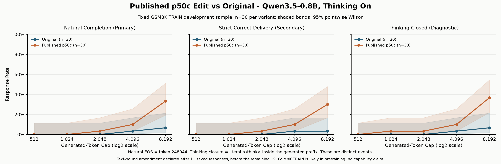

# P50c Thinking-On Completion Report

> Curated copy of a completed historical report. Original flat-layout paths refer to the local workbench reconstructed by `scripts/lab.py`; full raw runs are not distributed with the code. The original report is preserved locally.

On 30 fixed GSM8K TRAIN questions, the published p50c edit yielded 10/30 naturally finished thinking-on responses by 8,192 generated tokens, versus 2/30 for the saved original model. Under a text-bound handling amendment declared after 11 saved responses and before the remaining 19, strict correct delivery was 9/30 edited versus 1/30 original. The separate thinking-closure diagnostic was 11/30 edited versus 2/30 original; it is the endpoint relevant to the unverified article-based expectation, not the same event as natural EOS. The edited run accounted for 226,865 of 250,000 tokens, every accepted edited response carries verified published tensor hashes, and original target weights were restored. GSM8K TRAIN is likely in Qwen's training data (per-item inclusion is unverified), so these one-model development results are not a capability or benchmark claim.

## Question

Does the full published p50c edit improve natural completion versus the saved
original model on these same 30 development questions? The primary endpoint is
natural EOS by 8,192 generated tokens. Strict correct delivery is secondary.
Thinking closure is a separate diagnostic, not a substitute primary outcome.

## Fixed Design

- Model: Qwen3.5-0.8B, revision `2fc06364715b967f1860aea9cf38778875588b17`,
  original BF16 checkpoint, eager attention/dynamic cache, batch size 1.
- Questions: exactly the same 30 GSM8K `main` TRAIN items and integer answers,
  sampling seed 20261106, per-question generation seeds 0-29.
  Dataset revision `740312add88f781978c0658806c59bc2815b9866`.
- Thinking on only (`enable_thinking=True`); fixed instruction:
  `Please reason step by step, and put your final answer within \boxed{}.`. Every actual prompt matches its original.
- Same sampling: temperature 0.6, top-p 0.95, top-k 20, generated-token presence
  penalty 1.5, repetition penalty 1, one beam. One 8,192-token call per completed
  item; caps 512/1024/2048/4096/8192 are post-hoc views, not extra generations.
- Full published edit: layers 15 and 19, strength 1.0, 130,188 BF16 values.
  Rikiya Takehi et al., `RikiyaT/lm_understand-logs`,
  commit `4d09ba6d6a7e891dd8063974dfe81b3d78e3494f`, CC BY 4.0, used without modification.
- EOS remains 248044 only. A closed `</think>` and token 248046 do not stop
  generation. Correct delivery requires natural EOS within the cap. Bounded
  decoded text uses the unchanged strict final boxed-integer grader; an approved
  text-bound exception, when present, is disclosed separately and never correct.
- Closure means exact literal `</think>` wholly inside locally decoded generated
  token IDs `[:k]`, skip_special_tokens=False, no cleanup, excluding the prompt.
  It does not require EOS or correctness; each response counts once per cap.
- Original control: reuse only its 30 thinking-on main records, never regenerate,
  and exclude thinking-off/short-validation responses from the comparison.
- Strict determinism: CUBLAS_WORKSPACE_CONFIG=:4096:8 before CUDA, threads 1/1,
  deterministic algorithms with warn_only=False, TF32 off, eval/inference mode.
  No wall-clock cutoff. No new prefix checks: identical frozen generation core
  and determinism reuse the four passing original checks, not a newly measured
  guarantee for all edited prefixes.

The baseline and earlier local toy pilots were known before this predeclaration;
new matched edited GSM8K responses were not. The article-based ~30% edited
closure expectation (informal 28-40% range, unedited ~9%) was estimated and
unverified, not a confidence interval, natural-EOS expectation or pass/fail gate.

## Results

### Natural Completion (Primary)

Counts, rates and 95% pointwise Wilson intervals.

| Token cap | Original | Published p50c |
|---:|---:|---:|
| 512 | 0/30 (0.0%; 0.0%-11.4%) | 0/30 (0.0%; 0.0%-11.4%) |
| 1,024 | 0/30 (0.0%; 0.0%-11.4%) | 0/30 (0.0%; 0.0%-11.4%) |
| 2,048 | 0/30 (0.0%; 0.0%-11.4%) | 1/30 (3.3%; 0.6%-16.7%) |
| 4,096 | 1/30 (3.3%; 0.6%-16.7%) | 3/30 (10.0%; 3.5%-25.6%) |
| 8,192 | 2/30 (6.7%; 1.8%-21.3%) | 10/30 (33.3%; 19.2%-51.2%) |

### Strict Correct Delivery (Secondary)

Counts, rates and 95% pointwise Wilson intervals.

| Token cap | Original | Published p50c |
|---:|---:|---:|
| 512 | 0/30 (0.0%; 0.0%-11.4%) | 0/30 (0.0%; 0.0%-11.4%) |
| 1,024 | 0/30 (0.0%; 0.0%-11.4%) | 0/30 (0.0%; 0.0%-11.4%) |
| 2,048 | 0/30 (0.0%; 0.0%-11.4%) | 1/30 (3.3%; 0.6%-16.7%) |
| 4,096 | 1/30 (3.3%; 0.6%-16.7%) | 3/30 (10.0%; 3.5%-25.6%) |
| 8,192 | 1/30 (3.3%; 0.6%-16.7%) | 9/30 (30.0%; 16.7%-47.9%) |

### Thinking Closed (Diagnostic)

Counts, rates and 95% pointwise Wilson intervals.

| Token cap | Original | Published p50c |
|---:|---:|---:|
| 512 | 0/30 (0.0%; 0.0%-11.4%) | 0/30 (0.0%; 0.0%-11.4%) |
| 1,024 | 0/30 (0.0%; 0.0%-11.4%) | 1/30 (3.3%; 0.6%-16.7%) |
| 2,048 | 0/30 (0.0%; 0.0%-11.4%) | 1/30 (3.3%; 0.6%-16.7%) |
| 4,096 | 1/30 (3.3%; 0.6%-16.7%) | 3/30 (10.0%; 3.5%-25.6%) |
| 8,192 | 2/30 (6.7%; 1.8%-21.3%) | 11/30 (36.7%; 21.9%-54.5%) |

### Mean Tokens

Mean(min(actual generated length, cap)); no Wilson interval applies to this continuous mean.
These are counterfactual capped lengths, not separate generations or additional compute.

| Token cap | Original | Published p50c |
|---:|---:|---:|
| 512 | 512.0 | 512.0 |
| 1,024 | 1024.0 | 1024.0 |
| 2,048 | 2048.0 | 2014.9 |
| 4,096 | 4047.9 | 3927.4 |
| 8,192 | 7932.7 | 7289.1 |

## Pre-Declared Amendment

The user approved this amendment **after 11 saved responses and before any of the remaining 19 generations**.
Declaration time: `2026-11-07T12:18:52.439756+00:00`; amendment SHA-256: `faf77e94709253d5c1fe07575eebae4488d22ce97e1c27edc796bd02cb22f625`.
The original plan, original 23 source files, 11 canonical records and their outcomes remain unchanged.
Prior partial report/summary/analysis and the original journal are archived under `amendments/text_bound_01/before/`.

- Persist generated token IDs, then raw text when decodable, before response validation or grading.
- Flag decoded lengths outside 1-200,000 characters as `text_bound_violation`, recording the exact character length.
- Such responses have strict-correct=false even if boxed text appears; natural EOS and literal thinking closure come from token IDs only.
- Full oversized/empty raw text is retained separately; the accepted JSON record need not embed unbounded text.
- Structural token/EOS/provenance checks and strict determinism remain mandatory; decoding failures retain IDs and stop.

An inference-free regression proved byte-for-byte preservation and identical outcomes/tables for the saved 11.
The sampling call, forked RNG setup and seed calls are AST-identical to the original core; no new prefix generation was added.
Item `gsm8k_train_02851` was regenerated with the same seed and configuration, followed by the 18 never-started items.
The original failed attempt had no persisted raw output, so exact equality to that old output cannot be empirically verified.
Its full 8,192-token reservation remains charged and is not reconciled against the regenerated response.

This is an approved prospective handling change after partial results were known, **not an untouched initial pre-registration**.
It changes no saved outcome among the original 11 and must not be hidden when sharing results.

### Text-Bound Violations

| Question | Decoded characters | Natural EOS index | Thinking closed by 8192 |
|---|---:|---:|---|
| gsm8k_train_02851 | 669,118 | None | False |

## Paired Effects

Each row pairs the same 30 question IDs and seeds. Difference = edited minus original, in percentage points.
Exact two-sided McNemar tests use discordant pairs; zero discordance gives p=1.
Holm adjustment covers five caps separately for each outcome, not all 15 tests jointly.
Secondary/diagnostic results cannot replace the primary natural-completion endpoint.

### Natural Completion (Primary)

| Cap | Edited wins | Original wins | Ties | Difference (pp) | Exact p | Holm p |
|---:|---:|---:|---:|---:|---:|---:|
| 512 | 0 | 0 | 30 | +0.0 | 1 | 1 |
| 1,024 | 0 | 0 | 30 | +0.0 | 1 | 1 |
| 2,048 | 1 | 0 | 29 | +3.3 | 1 | 1 |
| 4,096 | 2 | 0 | 28 | +6.7 | 0.5 | 1 |
| 8,192 | 9 | 1 | 20 | +26.7 | 0.0214844 | 0.107422 |

### Strict Correct Delivery (Secondary)

| Cap | Edited wins | Original wins | Ties | Difference (pp) | Exact p | Holm p |
|---:|---:|---:|---:|---:|---:|---:|
| 512 | 0 | 0 | 30 | +0.0 | 1 | 1 |
| 1,024 | 0 | 0 | 30 | +0.0 | 1 | 1 |
| 2,048 | 1 | 0 | 29 | +3.3 | 1 | 1 |
| 4,096 | 2 | 0 | 28 | +6.7 | 0.5 | 1 |
| 8,192 | 8 | 0 | 22 | +26.7 | 0.0078125 | 0.0390625 |

### Thinking Closed (Diagnostic)

| Cap | Edited wins | Original wins | Ties | Difference (pp) | Exact p | Holm p |
|---:|---:|---:|---:|---:|---:|---:|
| 512 | 0 | 0 | 30 | +0.0 | 1 | 1 |
| 1,024 | 1 | 0 | 29 | +3.3 | 1 | 1 |
| 2,048 | 1 | 0 | 29 | +3.3 | 1 | 1 |
| 4,096 | 2 | 0 | 28 | +6.7 | 0.5 | 1 |
| 8,192 | 10 | 1 | 19 | +30.0 | 0.0117188 | 0.0585938 |

At the primary 8,192-token endpoint, the paired effect is
**+26.7 percentage points**:
9 edited wins, 1 original wins
and 20 ties; exact p=0.0214844,
Holm p=0.107422.

The observed edited thinking-closure rate is 11/30
(36.7%). Only this diagnostic is like-for-like in endpoint with
the article-based estimate; it is not a reproduction/verification of the
article's evaluation population or rate. Closure and EOS remain distinct even
when their counts coincide. No secondary/diagnostic result replaces the primary.

## Short Wrong Answers

No edited response both ends naturally within 1,024 tokens and fails the frozen strict grader.

## Token 248046 Diagnostic

Token 248046 remains diagnostic only, never an extra EOS.

| Variant | Responses containing 248046 | Total occurrences |
|---|---:|---:|
| original | 2 | 2 |
| edited | 10 | 10 |

Containing original responses (occurrence counts): gsm8k_train_06229 (1), gsm8k_train_01026 (1).

Containing edited responses (occurrence counts): gsm8k_train_05037 (1), gsm8k_train_01026 (1), gsm8k_train_04560 (1), gsm8k_train_05283 (1), gsm8k_train_06305 (1), gsm8k_train_05040 (1), gsm8k_train_02232 (1), gsm8k_train_01407 (1), gsm8k_train_07084 (1), gsm8k_train_03984 (1).

## Reliability And Cost

- Each start/resume loads and verifies originals, reapplies p50c and verifies both
  edited tensors before work. Every response carries its actual
  `verified_edited_tensor_sha256`; storage and analysis reject missing/mismatched
  hashes. A fresh-process gate cannot inherit verification from prior records.
- All 30 accepted records match the planned edited hashes and fixed
  original prompts. Verification is repeated immediately before every generation.
- The existing context restores originals in `finally`, including handled
  exceptions/interrupts; independent post-run original hashes are verified.
  A hard kill cannot execute cleanup, but no edited weights are saved and a new
  process must reload/reverify pristine disk weights before reapplying the edit.
- Edited allocation: 226,865/250,000 accounted tokens:
  218,673 completed, plus
  8,192 unreconciled full-cap reservations.
  Reservations are durable before generation; completed records are fsynced
  before the next call, and completed work is never repeated.
- Recorded generation wall time totals 2.79 hours, aggregate
  21.73 tokens/s, peak allocated GPU memory 1.83 GiB. Times may include
  host pauses; the original baseline had an unusually long timing observation.
  These are not controlled GPU performance comparisons.

All individual edited timings are retained, without outlier removal:

| Question ID | Generated tokens | Generation wall seconds | Tokens/s |
|---|---:|---:|---:|
| gsm8k_train_06819 | 8192 | 377.43 | 21.70 |
| gsm8k_train_03171 | 8192 | 403.84 | 20.29 |
| gsm8k_train_05037 | 5526 | 259.56 | 21.29 |
| gsm8k_train_06229 | 8192 | 396.64 | 20.65 |
| gsm8k_train_01026 | 1055 | 49.66 | 21.25 |
| gsm8k_train_05128 | 8192 | 398.78 | 20.54 |
| gsm8k_train_04560 | 7703 | 361.86 | 21.29 |
| gsm8k_train_05283 | 7883 | 369.64 | 21.33 |
| gsm8k_train_06305 | 6729 | 313.44 | 21.47 |
| gsm8k_train_01227 | 8192 | 383.32 | 21.37 |
| gsm8k_train_04331 | 8192 | 385.28 | 21.26 |
| gsm8k_train_02851 | 8192 | 441.79 | 18.54 |
| gsm8k_train_05040 | 7420 | 362.03 | 20.50 |
| gsm8k_train_02232 | 7290 | 339.85 | 21.45 |
| gsm8k_train_03114 | 8192 | 385.01 | 21.28 |
| gsm8k_train_00949 | 8192 | 384.83 | 21.29 |
| gsm8k_train_02809 | 8192 | 386.82 | 21.18 |
| gsm8k_train_01407 | 2618 | 116.32 | 22.51 |
| gsm8k_train_06959 | 8192 | 372.63 | 21.98 |
| gsm8k_train_02855 | 8192 | 362.55 | 22.60 |
| gsm8k_train_01238 | 8192 | 351.42 | 23.31 |
| gsm8k_train_03547 | 8192 | 360.35 | 22.73 |
| gsm8k_train_02272 | 8192 | 351.12 | 23.33 |
| gsm8k_train_06630 | 8192 | 353.57 | 23.17 |
| gsm8k_train_07084 | 5051 | 215.92 | 23.39 |
| gsm8k_train_04313 | 8192 | 360.48 | 22.73 |
| gsm8k_train_06362 | 8192 | 351.98 | 23.27 |
| gsm8k_train_03984 | 3558 | 155.09 | 22.94 |
| gsm8k_train_06256 | 8192 | 353.56 | 23.17 |
| gsm8k_train_01093 | 8192 | 356.86 | 22.96 |

## Limitations

- Only 30 selected TRAIN development questions, one seed per item and one 0.8B
  checkpoint. The original and edited runs occurred at different times.
- GSM8K TRAIN is likely in Qwen's training data; per-item inclusion is unverified.
  Absolute accuracy is not a capability or benchmark claim.
- n=30 generally detects only large effects (~25+ percentage points); paired
  discordance and multiplicity matter. Non-significance is not equivalence.
- Wilson bands are pointwise binomial intervals, not simultaneous bands or
  confidence intervals on paired differences/mean tokens. Holm control applies
  within each five-cap outcome family, not globally across the 15 comparisons.
- The original prefix validation is inherited under an identical implementation;
  it is not a fresh empirical edited-weight check. Integer annotation parsing
  does not independently prove all reference solutions or rule out near duplicates.
- The closure estimate from public article logs remains unverified locally and
  may come from different questions, sampling and stop semantics.
- If present, the text-bound handling amendment was declared after 11 outcomes
  were known, before the remaining 19; its scope and all violations are disclosed.

## Stop

Independent restoration check: **PASSED in both artifacts**. In `summary.json`
and `weight_verification_20261107T123416_340386Z.json`, `verified_after_restore`
is true and `original_after_restore` exactly matches the planned base hashes.
The full observed/planned hash maps are retained in `restoration_audit.json`.
No status field is used as proof of restoration; missing or mismatched evidence
would replace this Stop section with a restoration-failure warning.

The one fixed edited comparison is complete. No held-out use, model/tensor saves,
new downloads/installations, extra conditions/seeds/strength search, commits or
pushes. Original target weights are restored and verified; prior reports,
scorers, records and notebooks remain unchanged. No further generation is
scheduled, regardless of these results.
